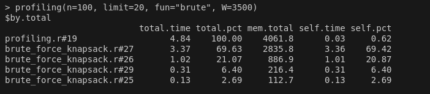
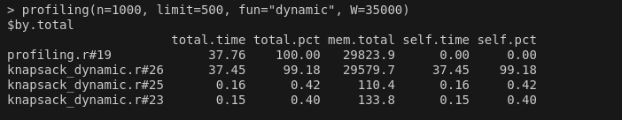
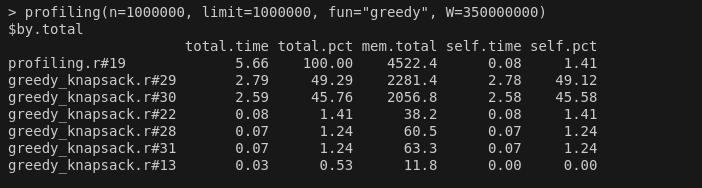

```{r, include = FALSE}
knitr::opts_chunk$set(
  collapse = TRUE,
  comment = "#>"
)
```
# Introduction

In this package we try three different algorithm for the knapsack problem. 

In brute_force_knapsack we check each possible combination, making slow progress, but ensuring that we get the best possible result.

On the other way, in greedy_knapsack we obtain a fast result, at the cost of accuracy.

Finally, knapsack_dynamic is a more efficient algorithm than brute force, that still obtains the best result.

---

# Installation

The package can be installed with the following command.

> pak::pak("ValentinRapetti/Lab6")

---

# Functions

brute_force_knapsack(x, W) : Returns a list with the "value" and "elements" of the solution found using brute force.

knapsack_dynamic(x, W) : Returns a list with the "value" and "elements" of the solution found using a dynamic knapsack.

greedy_knapsack(x, W) : Returns a list with the "value" and "elements" of the solution found using the greedy algorithm.

profiling(n, limit, W, fun) : A function that prints on screen the result of the R profiler, for the different implemented functions in this package.

---

# Example

Here is a quick example of how to use this package. In this case we are using the brute force algorithm with 8 objects.
```{r setup}
library(Lab6)
RNGversion(min(as.character(getRversion()),"3.5.3"))
set.seed(42, kind = "Mersenne-Twister", normal.kind = "Inversion")
n <- 1000000
knapsack_objects <- data.frame(w = sample(1:4000, size = n, replace = TRUE),
                               v = runif(n = n, 0, 10000))

brute_force_knapsack( knapsack_objects[1:8, ], W=3500 )
```

---

# Execution times

Getting a correct result doesn't necesarily imply that our functions are good. In this section we demonstrate how the different algorithms have "similar" execution times, even when considering orders of magnitude more objects.

## Brute force:
```{r, eval=TRUE}
system.time( brute_force_knapsack( knapsack_objects[1:20, ], W=3500 ) )
```

## Dynamic:
```{r, eval=TRUE}
system.time( knapsack_dynamic( knapsack_objects[1:500, ], W=35000 ) )
```

## Greedy algorithm: 
```{r, eval=TRUE}
system.time( greedy_knapsack( knapsack_objects[1:1000000, ], W=350000000 ) )
```

---

# Profiling

In order to find the sections of code that consume the most time, and thus need optimization, we utilized the R profiler.

## Brute force:
```{r, eval=FALSE}
profiling(n=100, limit=20, fun="brute", W=3500)
```
```{r out.width = '90%', echo = FALSE}

```

We can see that the most time-consuming lines are all in the section of code trying to find the best combination. These lines are (in order): doing vector multiplications, calculating and assigning a binary list, and implementing an if and for. 

## Dynamic:
```{r, eval=FALSE}
profiling(n=1000, limit=500, fun="dynamic", W=35000)
```
```{r out.width = '90%', echo = FALSE}

```

In this case we see that the main bottleneck relies on a comparison that is being done for every single element of the 1000x35000 matrix.

## Greedy algorithm:
```{r, eval=FALSE}
profiling(n=1000000, limit=1000000, fun="greedy", W=350000000)
```
```{r out.width = '90%', echo = FALSE}

```

Lastly, we see that in the greedy algorithm the main issue is adding the new weights and values to an existing list.